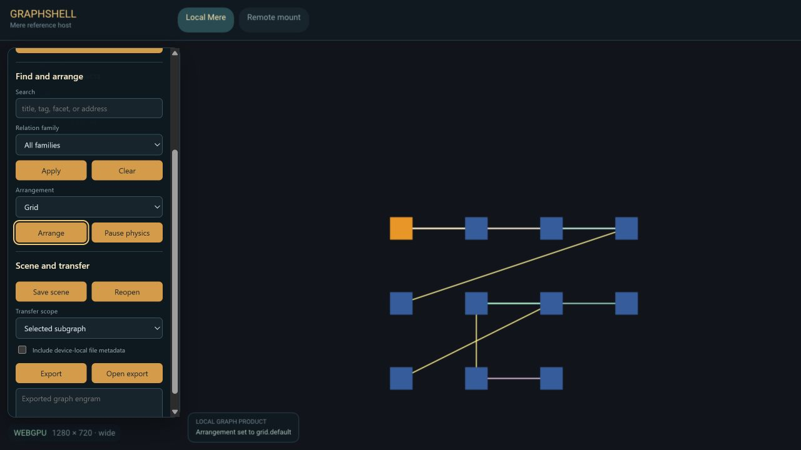

# Mere

Mere is a platform for showing data in useful projections, reaching it
peer-to-peer wherever it lives, and sharing it on the user's terms. Each data
domain lives in a mere: a spatial graph of resources and the nodes they are met
through, which hosts project into canvases, tiles, and panes. Mere is not a
browser; [Turnstone](https://github.com/merely-made/turnstone) is the browser
built on it.

<p align="center">
  <br>
  <sub>Graphshell, Mere's reference host: a local graph arranged through the product's own search, relation, and scene controls.</sub>
</p>

## Status (2026-10-20)

Pre-release, under active development.

- Cargo workspace of 92 explicit members. The `mere` facade exposes graph,
  linked-data, canvas, workbench and query capabilities.
- Graphshell remains the complete reference graph host; Djinn supplies the local
  resident composition. Cambium and Conatus remain platform components here.
- [Eidetic](https://github.com/merely-made/eidetic),
  [Armillary](https://github.com/merely-made/armillary),
  [ESP](https://github.com/merely-made/esp),
  [Gemot](https://github.com/merely-made/gemot) and
  [Errand](https://github.com/merely-made/errand) are independently developed
  suppliers. Errand continues Smolweb's protocol history and crate identities.
  The workspace pins one immutable revision per promoted family.
- Graph canvas, content lanes, session persistence, comms and semantic queries
  have separate implementation and acceptance boundaries. Promotion does not
  establish new browser, network, model or physical-device capabilities.
- Working Rust toolchain: 1.99.1; shared declared minimum: 1.97.1.

The [family promotion plan](design_docs/archive_docs/2026-10-28/2026-10-19_family_promotion_plan.md)
records source ownership, independent test gates and consumer cutover status.

## Design vocabulary

**The graph**: what a mere holds.
- *Resource*: what a canonical URL identifies. Claims about it (what a page says, cites, or derives from, and its tags) attach to the resource, each kept with who asserted it.
- *Surface*: what the user browses in. A surface shows one resource at a time; navigating changes which. Resources and surfaces are both nodes of the graph.
- *Strata*: the resource stratum (what things are) under the surface stratum (how they were met: trail, layout, groupings).
- *Aspect*: any way of dividing the graph: strata, planes (truth and curation), keeping, attention, socialization tiers, coverage.

A graph becomes a picture through two grammars that share one binding.

**Projection**: what is shown, and where.
- *Projection grammar*: the reusable vocabulary and operations: selection, derivation, visual encoding, arrangements, backgrounds, interactions, and provenance.
- *Scene recipe*: saved presentation choices: a source reading, visual encodings, an arrangement, and optional dynamics. Hosts can edit and reuse these definitions; execution supports a declared subset of the grammar.
- *Domain binding*: the connection to a domain's disclosed facts and owner-provided operations. Today the saved binding identifies the authority, domain and resource. Action advertisement and permission checks use separate owner/host interfaces; saving a recipe grants no permission to change its source.

So a timeline recipe isn't inherently a music feature or a writing feature. A domain supplies meaningful temporal facts; the recipe makes them legible. Likewise, a relationship layout can present lexical connections, musical relationships, or research references without treating those relationships as semantically identical.

**Dynamics**: how things move.
- *Dynamics grammar*: the reusable vocabulary of motion: terms (what acts on what, by which rule, carrying which state), what kind of motion each makes, and how they combine (weighted sums, groups, schedules).
- *Dynamics recipe*: a particular composition of those terms, saved, edited, and reused like a scene recipe.
- The same domain binding supplies both: a scene recipe names an arrangement and, optionally, a dynamics recipe.

An arrangement defines intended positions; physics acts on them. Each item's position is *seeded* (motion starts there), *pinned* (it stays) or *anchored* (it returns after a push or a drag), by the recipe's default or per item, seeded unless chosen. Meaning can live in the dynamics too: a semantic grouping becomes a pull among related items rather than a slot to return to.

Authored dynamics, role choices and intentional placements can be saved. Knot,
for example, retains those choices and placement traces as immutable versions.
Live simulation state and execution handles remain runtime-owned. Executing a
saved dynamics specification requires host validation and a runtime binding.

A workbench's own structure of frames, tiles, and splits is a *forme*, not an arrangement. A physics simulation's bodies, joints, fields, and emitters are a *world*, not a scene.

The implemented [scene pipeline](crates/cambium/scenes/README.md) compiles supported
recipes and disclosed facts into layout instructions and a projected scene;
the host draws it and supplies interaction. A renderer's drawing, such as a
Vello scene, is a different object from that projected scene or a physics world.
Cambium's [desktop host](design_docs/cambium_docs/technical_architecture/2026-09-03_cambium_architecture.md#shared-gpu-and-event-loop-ownership-2026-10-20)
supports a shared GPU render core and a caller-owned event loop; using the
standalone entry point does not establish one device across independent hosts.

## Use

Mere is consumed as a git dependency by
[Turnstone](https://github.com/merely-made/turnstone) (the browser app) and
other sibling repos. Runnable consumers in this repository live under `ports/`:
graphshell (the reference graph host and web presenter), djinn (the local
desktop resident), castellan (credential keeper), distillery (model works),
gazette (the directory port), moot (community: murmurs, moots, and coop), pelt
(the reference browser port over Genet's engine and Cambium's shell), signalman
(commissioning and operating Retinue stations). Tabard is the shared theme
authoring library under `crates/system/tabard`, used by platform crates and ports.
[Knot Editor](https://github.com/merely-made/knot-editor) is an independent
repository, not a Mere port: it owns files-in-place authoring, document and
vault authority, evidence, sync and publishing, and Djinn and Turnstone consume
it from one immutable revision through the generic Mere and Genet contracts. See
`knot-editor/design_docs/2026-09-01_knot_editor_repository_extraction_plan.md`.

```sh
cargo build
cargo test
cargo test -p mere-kernel    # single crate, by package name

```

`ports/graphshell` has no default binary; pick one explicitly (see
[`ports/graphshell/README.md`](ports/graphshell/README.md)).

### Portable and local dependencies

The root `Cargo.lock` records the portable graph. Use `cargo check --workspace
--locked` for that graph. Python 3.11+ can additionally check configuration,
package provenance and lock preservation with `python scripts/cargo_mode.py
verify`. Run acceptance checks in a clean checkout with documented platform
prerequisites; a local-path build is a separate receipt.

For sibling development, copy `.cargo/config.toml.example` to
`.cargo/config.local.toml` and adjust its paths for your checkout layout. Existing
users run `python scripts/cargo_mode.py setup` once from the repository root:
it preserves current locks and renames ignored automatic configs to opt-in local
configs. It does not overwrite an existing local config or local lock.

```sh
python scripts/cargo_mode.py local check --workspace
python scripts/cargo_mode.py local check --manifest-path ports/graphshell/web/Cargo.toml --target wasm32-unknown-unknown
```

The launcher requires Cargo 1.97+ and selects `<workspace>/.cargo/local/Cargo.lock`
even with `--manifest-path`. Commands run from the selected workspace root;
other relative command arguments are interpreted there. Local commands load
root and nested local configs;
ordinary Cargo commands do not. Use the launcher for editor check commands too
(an absolute script path works from a member directory). Editor metadata using
bare Cargo sees the portable graph. Do not set a global lockfile redirect.
Nested workspace portable locks and platform gates are tracked separately in
the [lattice plan](design_docs/archive_docs/2026-10-28/2026-09-16_lattice_sync_pass_plan.md).

Integration uses a tested set of published revisions. Local sibling changes do
not require immediate Git repins, and pin-only commits do not trigger reciprocal
repins. Advance pins when accepting a tested integration or a required fix.

## License

MPL-2.0 (see `LICENSE`).

---

*This README was generated by AI and will be edited by the author upon
release.*
