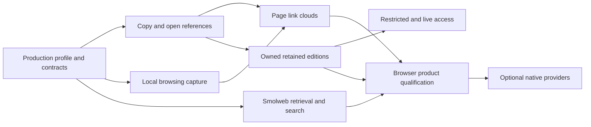

# Application experience: link-first sharing and the browser companion

**Status:** 2026-11-04: implementation plan. No phase has been implemented or
qualified by this plan. Existing mechanisms below are source observations;
integration choices and workload bounds are proposals unless identified as an
owner decision.
**Design:** [portable application experience brief](../../2026-11-04_portable_application_experience_brief.md).
**First delivery:** a useful browser extension with no resident installed:
copy a source link, relate consented browsing, Fleece the current page, inspect
its link cloud with source context, open a node in the attached browser, and
reopen the local workspace. Add smolweb reads through replaceable gateways and
owned-release links without making either depend on a new transport system.

This is the cross-application integration plan in Mere. Graphshell's shared
library and web port supply the browser presentation; Turnstone supplies its
browser experience and native consumer. Do not create a second graph engine,
capture ledger or extension framework under the Turnstone name.

## Decisions

- **D1, begin with link-first sharing and the browser companion (2026-11-04):**
  **New delivery order; applies the brief and release-log D9–D11.** Mark:

  > alright, let's turn the application brief into an implementation plan, starting with link-first sharing and the browser companion. reuse what's already in the stack.

  Portable delivery precedes a contact workflow. Keep references, owned access
  and independent exports distinct. Start with the existing browser/capture
  and content seams; new glue must have a concrete missing boundary.

  Links: area applications · draws on release-log D9, release-log D10, release-log D11 · plans application-experience · summary begin with portable links and the browser companion using existing stack owners

## Ownership and reuse

| Existing owner and seam | Reuse here | Missing integration |
|---|---|---|
| Graphshell `handlers`, Chirograph advertised actions and `OpenAddressV1` | Typed address action, host offers and explicit acceptance | A narrow Copy link action and an attached-browser handler; keep native OS dispatch separate |
| Graph-kernel resource/access identity and the [link model](2026-10-28_link_model_plan.md) | Canonical resources, attributed assertions, link inspection, arrangements and promoted relations | Present occurrence context and copy/open actions; do not serialize derived pair links as new authority |
| Extension `background.js`, `capture-model.js`, `extension-profile.js`; Graphshell `capture.rs` | Consent, bounded capture queue, source scope, commit-before-ack and encounter-ledger admission | Browser lifecycle qualification, document-scoped page acquisition and a production local profile |
| Muniment IndexedDB and Graphshell's existing product/viewer split | Local graph, encounter persistence, persistence-state reporting and shared renderer | Production mount without fixture seed; concurrent panel/workspace admission |
| Genet Fleece and Mere `fleece` | Extraction, canonical text/selectors, capture evidence, selected portable clips | Per-hyperlink occurrence context and browser-acquisition adapter |
| `page-load`, `genet-host-api`, native `mere-fetch` and Errand | Request/outcome vocabulary, typed prompts, Stop/supersession, protocol fetch and parsing | Bounded gateway wire profile and asynchronous browser transport realization |
| Stickleback drops and the [release-log plan](2026-11-03_release_log_plan.md), R2/R4/R6 | Content identity, verified payloads, protected drops, release/reader authority and portable addresses | Product adapters for preparing, copying, opening and retaining selected owned content |
| Djinn/AppConnection, capability door and projection offers | Native/remote provider admission, leases, viewer authority and cancellation | Optional companion realization of the same actions, not a replacement local browser store |

The current site model is `crates/domain/site`; the
[source homes map](../technical_architecture/2026-10-28_source_homes_map.md#site-and-small-repository-scope-refinement-2026-11-04)
assigns the general static-site/serving library to Gemot. Implement against the
qualified owner at the time of the cut, without creating a second site model
or making ordinary publication require Moot membership.

Protocol-specific retrieval remains with Errand and host fetch composition;
Murm owns carriers and their observations. A gateway is a fetch-service
adapter, not a new Murm transport. Gaz/Gazette supply purpose-specific contact
and endpoint evidence later; Signalman can present routes later. Neither is a
prerequisite for copying a link or installing the companion extension.

## Contracts and constraints

These are implementation requirements, not new compile-ready APIs.

**Share preparation.** One small host action contract distinguishes:
reference; retained edition; and access to an owner-controlled live scope.
Its result exposes the canonical target, edition/live semantics, audience and
delegation scope, verification anchor where applicable, availability and
independent-retention status. The concrete types belong beside existing
address actions and release profiles, not a new sharing registry. UI state is
derived from the domain result; clipboard success is not publication success.

An ordinary URL needs no publication, signer, recipient or contact lookup.
An owned resource needs its selected export/grant and a reachable provider
before a peer-openable link is claimed. Do not copy a device-local resource ID
and label it shared. Unsupported modes are visibly unavailable. Contact
delivery is an adapter after link preparation; an email address is not proof
of the cryptographic audience.

**Resource versus delivery link.** Keep R4's canonical resource/edition
address independent of how another application opens it. Proposed browser
delivery is a replaceable HTTPS launcher carrying the public target/anchor in
its client-side fragment, plus paste/open inside the extension. Reuse the
existing web viewer and its self-hosted static distribution; do not require
every browser or OS to recognize the canonical custom scheme. The launcher
is neither a holder nor source authority, and need not receive the target at
its server. This is not an anonymity guarantee: its page code and the browser
handle the displayed target. Credential-bearing invitations need S3's own
reviewed delivery rules, not an arbitrary secret query/fragment. Freeze this
delivery encoding with R4 rather than adding a competing address grammar.

**Source and evidence.** Source URI, immutable acquired representation, exact
occurrence/selector, access identity, appearance and fetch route remain
separate. Preserve several hyperlink occurrences to one target. Fleece text
positions refer to its normalized text, not arbitrary browser DOM offsets.
A local observation is not an author's signed assertion. An inferred relation
does not replace the observed link or traversal that supplied its evidence.

**Identity and persistence.** Use a browser-local unassociated provenance
scope for local work without claiming custody-backed identity. Replace the
fixture mount; do not mint a fallback persona when a paired vault is locked.
Signing, private credential use and owner grant issuance require an admitted
provider until a separate browser custody profile is qualified. Public
reference copying, capture and public reading remain available without one.
Commit the IndexedDB transaction before acknowledging capture; prove reopen
in the separate restart gate.
Distinguish browser-local retention, eviction protection and a durable copy
on another device; `storage.persist()` is not a backup.

**Execution and network.** Packaged extension code owns privileged APIs.
Acquired content is data, parsed by the selected reader; it never becomes
remote executable code in a privileged extension page. Ordinary pages receive
no injected Mere APIs. Capture and gateway calls carry only their selected
inputs, never the full history or graph. Retention does not enable serving.

## Delivery order

The first reference/capture/link-cloud increment is independently useful.
S2 consumes release-log R2/R4/R6 as they qualify; it does not reimplement
them. R1's fork publication, off-iroh carriage, anonymous overlays, generic
applets and browser-engine parity do not block S1/B1/B2. N1 may proceed earlier
for private issuing/hosting, but absence of N1 cannot disable those increments.
Performance and accessibility are gates in every browser phase, not a final
optimization pass.

## Phases

### P0. Production local profile and bounded action contracts

**Owner:** Graphshell shared host/web port; receiving Turnstone profile.

Separate normal extension startup from scenario seeding in
`ports/graphshell/src/web_tree/product.rs`. Give the installed profile a
stable local provenance/store identity and explicit lifecycle; retain fixture
identity only in fixture entry points. Reuse the existing product/viewer
feature split rather than pulling authoring, native engines or custody into
every browser surface.

Freeze thin host adapters for Copy link, attached-browser open and page
acquisition, using the advertised-action and address-kind machinery. Validate
message sender, tab/document generation, operation correlation and byte limits
at the extension boundary. Page-supplied labels, URLs and messages cannot
authorize a host action. Define profile/epoch invalidation for pending work.

Panel and workspace views must share committed state under one writer or the
existing owner transaction/admission mechanism. Do not assume multiple Wasm
mounts may independently seed or overwrite one database. Reuse request
sequencing and transactions; a new general event bus is unnecessary.

**Done when:** a fresh install opens empty production state without the native
host or fixture persona; close/reopen preserves its local scope; scenario
fixtures still use separate stores; a second simultaneous view observes the
same committed graph without lost edits; stale or wrong-document messages
cannot mutate it; identity-gated operations name the missing provider.

### S1. Copy a reference and open it in the attached browser

**Needs:** P0. **Owner:** shared Graphshell actions plus extension host adapter;
native Turnstone adopts the shared preparation result.

Make Copy link primary for a selected resource. Reuse kernel address parsing
and source resolution, preserve the actual target/query/fragment rather than
silently substituting a tracking-cleaned history identity, and show what is
being copied. An explicitly selected cleaned reference is a separate result.
Delivery uses the host clipboard on a user gesture; refusal leaves selectable
text and a visible failure, not a false success. OS share delivery is optional.

Realize the existing address-intent family through an attached-browser
handler. Ordinary HTTP(S) nodes use the current browser's tab API; smolweb
nodes route to the extension reader when supported. Keep the native
`system.default` handler and its reviewed OS dispatch distinct. Unknown,
executable, internal and unsupported schemes are refused, not passed to a
shell. No display or hover alone dispatches navigation.

**Done when:** copying an external reference works without identity/contact
access or a resident; a second clean client can open the exact address;
forwarding changes no source permissions; two occurrences copy the selected
target correctly; clipboard denial and unsupported schemes are reported; open
lands in the attached browser without launching another browser/application.

### B1. Relate browsing locally, with the resident absent

**Needs:** P0; exercise S1 as soon as available. **Owner:** extension capture
adapter, Graphshell capture host and Eidetic encounter ledger.

Reuse `capture.status/configure/pull/ack`, source profile/history generation,
parent evidence and the existing atomic graph/access/trace/ledger transaction.
Preserve sanitization, excluded origins, private-window policy, bounded queues,
coverage reports and permission removal. History permission is for visits;
it does not grant page DOM access. Revoke stops future intake and pending work;
forget uses the existing ownership-aware removal rather than deleting a
canonical resource another owner retains.

Mount the same workspace through Chrome's side-panel and Firefox's sidebar
adapters, with the existing extension tab as the full workspace/fallback.
Keep browser-specific panel lifecycle out of graph semantics. User-selected
new-tab/home entry is additive; PWA delivery later shares the presentation,
not extension permissions. MV3 worker globals are never the only durable
capture queue. Native bridge failure does not fail local startup.

**Done when:** headed Chromium and Firefox each capture a consented traversal,
show its actual evidence, restart the background worker/browser and reopen
the same local graph without a resident; duplicate delivery is absorbed;
failed transactions do not ack; out-of-order/missing-parent intake retains
honest coverage; permission removal and source-generation change reject stale
events; private/excluded browsing stays out of the retained/exportable set.

### B2. Fleece a page into an inspectable link cloud

**Needs:** S1 and B1. **Owners:** Genet's Fleece extractor, Mere's Fleece
adapters, Graphshell graph/presentation and the extension acquisition adapter.

Start with a user-invoked current-document acquisition using the browser's
`activeTab`/scripting model. Ongoing DOM observation is an additional
per-origin opt-in. Restricted pages, inaccessible frames, closed shadow roots,
truncation and changed documents produce explicit coverage, not invented
complete snapshots. Bind the bounded snapshot to the actual sender document,
final source/base URL and acquisition kind; an observed DOM snapshot is not
an original network response. Do not refetch through a gateway to pretend it
is the browser's authenticated current page. Respect the existing capture
policy and exclude credential/form-control values from the default acquisition;
permission to observe visits is not consent to capture every page input.

Extend the shared Fleece extraction result to associate each hyperlink
occurrence with preserved text/selector context. `html_links()` is useful for
a frontier but discards duplicates; `extract_links()` retains anchor text but
does not yet expose full surrounding occurrence context. Add that missing
capability once in the extractor and consume it in native and browser paths.
Use existing capture evidence, Web Annotation selectors and retention adapters;
do not implement a separate JavaScript text normalizer or quote resolver.

Project assertions into the existing graph. Hover and keyboard focus expose
the selected occurrence, source and evidence; several contexts remain
selectable for one target. Reuse the existing link inspection and arrangement
machinery. Automatic updates preserve manual placement/pinning and selected
context. Fields/tags use the existing curation/dynamics owners; do not create
extension-only physics or save transient path geometry as source truth.

**Done when:** repeated links to one target retain distinct contexts; base
resolution, Unicode/combining text, changing DOM and unavailable subframes have
positive/refusal fixtures; hovering/focusing after offline reopen shows the
captured context rather than requerying the live page; URL deduplication does
not merge occurrence evidence; observed, traversed and inferred relations are
distinguishable; pan/drag/open remain responsive during acquisition/layout.

### B3. Smolweb retrieval and search through replaceable gateways

**Needs:** P0/S1; independent of release-log R1 and anonymous carriers.
**Owners:** portable `page-load` vocabulary, browser async fetch adapter,
native `mere-fetch`/Errand service composition, existing Nematic readers.

Add a versioned, bounded wire realization beside the existing sans-IO
`page-load` vocabulary, with a transport-free optional codec. Feed it through
the existing request IDs, typed outcomes, Stop and supersession. The browser
uses asynchronous HTTPS; it must not import the blocking `Fetch` handle or
its Tokio runtime. Native gateway composition reuses the existing protocol
fetchers. This wire adapter is new work, not an existing API claim.

First qualify public Gemini reads and the existing gemtext reader. Responses
carry original bounded bytes, requested/final canonical source, media type,
native protocol status/prompt/redirect facts and route/observer facts. HTTP
gateway failure is distinct from origin protocol failure. Preserve typed input,
client-certificate and certificate-change outcomes; gateway-observed TLS is
labelled as such. No shared client identity, silent certificate acceptance,
POST-to-GET conversion or implicit submission. Sensitive input and private
credential operations require an explicitly capable route; the public profile
refuses them. Add Gopher/Micron only through the same profile and their own
protocol tests, not by labelling rendered HTML as original bytes.
Adapt Nematic's portable document output to the existing Graphshell reading
presentation in `ports/graphshell/src/web_tree/reading.rs`; native Pelt/window
hosting is not the browser retrieval implementation.

Bound decoded and encoded bytes, metadata, redirects, time, concurrency and
parser work; cancel superseded requests. A shared gateway's deployment policy
must prevent unintended private/loopback/link-local fetching, including after
DNS resolution and redirects, and bound client resource use. An admitted own
device can have a distinct explicitly configured local-network policy.

Ship a replaceable provider catalog; endpoint hints are not resource authority.
Prefer admitted own devices/selected contacts when present. Public defaults
need independently operated alternatives and tested failover; an operator's
participation is a deployment prerequisite, not a fact assumed by this plan.
The catalog is bundled/cached and does not receive every requested URL. Keep
route choice stable within policy and inspectable; refuse a privacy/credential
downgrade. Never upload history/graph for selection. A one-gateway fixture or
manual URL configuration alone does not qualify out-of-box public retrieval.

Search retained resources through the existing
`ports/graphshell/src/web_tree/product/query.rs` and retained-content query
seams. A remote
smolweb search provider is separately configured and receives the submitted
query only; its results are references opened through the selected reader
route. A fetch gateway is not implicitly a search index.

**Done when:** a fresh extension with no resident reads and searches supported
smolweb, preserves native status and canonical identity, and survives one
default provider's loss without a mandatory central resolver; late replies
cannot replace a stopped/newer load; malformed/oversize answers fail within
bounds; original bytes render and reopen offline; gateway translation is not
called end-to-end origin verification; route changes and credential refusals
are visible. Test client-verifiable signed-release evidence separately in S2.

### S2. Copy a link to an owned retained edition

**Needs:** S1; qualified release-log R2/R4/R6 supplier work.
**Owners:** release/reader domain, selected-export adapters and receiving hosts.

Reuse `fleece::portable_clip::export_selected_clip`, `ClipPackageV1` and the
existing source/part/selector model for clips. Reuse site snapshot V1 for
sites, and Stickleback's selected export/drop/chunk verification where the
release carries operations/blobs. Apply a domain selection before traversal;
neither export the whole graph nor follow source URLs/private backing as
implicit dependencies. A local clip package is not yet a discoverable release.
Use the receiving `ClipExportScope` and reading/export lifecycle rather than
adding a second selection/review implementation in the extension.

Bind the selected bytes/provenance to the release-log plan's authority and
address grammar. Provider hints remain hints; local readers verify the
original bytes/evidence before admission. A capable extension uses the same
portable verifier and remembered-history rules as native readers; no native
transport is pulled into that verifier. Preserve authenticity versus limited
freshness. Missing objects remain pending, never a falsely complete edition.

Supply the browser's missing read realization: a holder/gateway can return
the original bounded release evidence and manifest/blob objects over HTTPS,
using the same drop/blob identities and codecs. Native iroh availability alone
does not make a browser-openable link. An admitted WebRTC provider is an
additional route, not a mandatory first-install dependency. Keep this original
byte path distinct from R9's translated-HTML publication view. Open/paste and
the HTTPS launcher must resolve the same canonical target and verify the same
edition; a launcher domain change does not change resource identity.

Prepare/publish through the owning domain. Copy link becomes available when
its selected availability condition is met. Distinguish prepared, verification
failed, replication pending, available, retained locally and serving. Reuse
holder acknowledgements and configured completion policy; a transport/drop
receipt is not a new durable holder promise. The receiver explicitly keeps
the edition under its own local retention policy.

**Done when:** an ordinary browser delivery link and extension paste/open
reach the same edition; browser/native clients exchange one selected annotated clip
with only approved parts, verified content and original provenance; a cold
reader succeeds without contacting the author when a holder remains; tampered,
truncated and known-rollback material refuses; an older authentic release
states freshness limits; an independent copy reopens after the publisher and
gateway disappear; edits acquire recipient lineage without original-author
authority; no private history, grants or undeclared backing leaks into export.

### S3. Audience-restricted and live links

**Needs:** S2 plus the applicable domain's grant/credential provider.
**Owners:** domain authority, Dramatis custody/admission, Gemot for governed
sharing; Graphshell/Turnstone supply the receiving presentation.

Extend the same preparation/open result for a named persona, selected kin/kith
subset and an explicitly public/bearer mode where the owner supports it.
Reuse existing delegation and protected drops in governed cases; ordinary
sharing needs its own qualified issuer/verifier adapter and stays usable
without an obligatory Moot. Do not infer that a contact endpoint is the
audience key or that a signed package grants access to a mere.

Live co-op uses the existing admitted host/projection session; governed Moot
exposure and static site publication retain their existing owners. Forwarding
an identity-restricted link conveys no grant. Revocation/expiry/disconnect stop
future admitted access as specified by the owner, without claiming erasure of
independent plaintext already retained. Namespace-following replicas are
explicitly different from independent exports; adopting Willow is not part
of this plan.

**Done when:** the intended persona opens a restricted link and a third persona
cannot after forwarding; the same delivery path can carry a public reference
without claiming audience control; stale sessions/grants refuse after the
owner's authority change; an exported copy remains independent; live links
report an offline host instead of masquerading as an offline retained edition.

### Q1. Product and performance qualification

**Needs:** B2/B3 and the S2 receiving path for the combined release; qualify
the earlier reference/capture increment independently. **Owners:** Graphshell
web host, shared rendering/dynamics suppliers, Turnstone receiving profile.

Extend existing `web_timing`, scenarios, browser capture smoke fixtures and
host tests. Do not add a parallel benchmark or synthetic-browser framework.
Keep native, API-simulation, Wasm compilation, headed extension behavior and
physical device evidence separate. Test Chromium and Firefox, native provider
absent, and declared old/new supported hardware. Browser-store distribution
and installed release IDs need their own install/update/revoke receipt.

Proposed initial stress fixture: 10,000 retained encounters, 500 visible
resources and 1,000 displayed relation pairs; repeated occurrence contexts;
continuous capture/layout updates, plus a 1,000-visit queued replay and bounded
page extraction during pan, drag, hover/focus and node opening. Freeze input
sizes, queue caps and actual browser/display configuration before measuring.
Use projection/visibility bounds rather than loading/drawing every retained
resource. Extend timing with p99, missed-refresh and input-to-visible latency.

At a 60 Hz display, target p95 presented-frame interval within 1.1 refreshes,
p99 within two refreshes, fewer than 1% missed refresh opportunities, and p95
input-to-visible response within 50 ms across the active fixture. Record long
stalls and memory/queue high-water marks. These are proposed acceptance
thresholds, not measured performance. Averages, stopped dynamics or a hidden
panel do not pass. Browser scheduling/GPU traces are not proof of native
physical scanout. Fix repeated work at its shared owner after profiling.

**Done when:** the applicable increment passes headed browser lifecycle,
keyboard/focus/readability and active-load pacing gates with frozen workload
and source/bundle identities; denial, provider failure, restart and offline
reopen are exercised; any reduced supported workload is explicit in the
release profile rather than hidden by a headline 60 fps claim.

### N1. Optional native providers and later application profiles

**Needs:** the corresponding local action/reader contracts; does not block
S1/B1/B2 or public B3. **Owners:** existing Djinn/capability door, domain
providers and product shells.

Reuse AppConnection, native messaging, provider permission/viewer grants,
generation leases and bounded request framing. Native/paired providers add
direct smolweb, custody-backed issue/decrypt, publication and holding. Preserve
the local browser store and resource identity when routes attach/detach;
invalidate late results without dropping independent local data. Serve only
after an explicit retention/serving choice. Existing WebRTC admission and
carrier qualification remain in the [browser carrier plan](2026-10-28_browser_carrier_plan.md).

**Done when:** attaching a native provider changes available operations/routes
without changing canonical resources or requiring data migration; locked
custody and disconnect have bounded refusals; ordinary capture/copy/read still
work after detaching; holding uses release-log R5's custody/availability gates.

Follow-on work retained here: focused mobile receiving must reopen its local
domain with Graphshell absent; a PWA must declare its actual permission/storage
profile and needs no browser-history APIs; shareable applets need packaging,
instance grants and upgrade/revoke gates over existing mods/contributions.
These require separate bounded implementation cuts before execution. General
applet ABI, OHTTP/anonymity services, WPT/Widevine, other-platform app runtimes
and Distillery enrichment do not enter this first delivery's dependency cone.

## Findings — source inspection, 2026-11-04

- Mere `a9fa5c85c`: the extension manifests install storage/native messaging and
  make history/tabs/webNavigation optional; they do not yet declare the panel,
  active-document acquisition or gateway-host permissions above. The action
  currently opens `graph.html`; `bridge.js` owns native connection separately.
  `loader.js` prepares capture then mounts the Wasm portal. Sources:
  `ports/graphshell/web/extension/README.md`, manifests/background/bridge and
  `ports/graphshell/web/loader.js`.
- The current product mount opens IndexedDB but constructs
  `SelectedPersonaRef` with `FIXTURE_PERSONA_ADDRESS` and calls
  `GraphshellApp::open_or_fixture`: `ports/graphshell/src/web_tree/product.rs`.
  That is a reusable reference host, not qualified production profile identity.
- Address offers already exist in `ports/graphshell/src/handlers.rs`; the
  receiving native web-only dispatch is
  `ports/graphshell/mere/src/browser.rs`. Neither proves a browser clipboard
  or attached-tab realization exists.
- `crates/fleece/src/page_links.rs` resolves/deduplicates targets. Genet's
  `genet/components/fleece/src/lib.rs` has a rect-free `Link` with href/text/rel
  and canonical-text selector facilities, but no full per-link context record.
  This shape was also checked on fetched Genet main `55f3908edff`.
- `crates/fleece/src/eidetic_bridge.rs` preserves caller-supplied capture
  evidence; `crates/fleece/src/portable_clip.rs` exports approved part closure
  without traversing private backing or external source URLs.
- `crates/system/page-load/src/lib.rs` already gates outcomes by request and
  carries typed input, client-certificate and certificate-change failures.
  `crates/system/fetch/src/handle.rs` is explicitly blocking and refuses
  unsupported rich requests. Reuse the former in Wasm; reuse the latter only
  behind the native adapter.
- `genet/components/genet-host-api/lib.rs` has portable request/response
  contracts. They do not alone encode smolweb prompt and route-observer facts.
  A bounded gateway codec remains new work, not a generic serialization of an
  HTTP-looking success response.
- Eidetic `171f7892`: `eidetic/crates/stickleback/src/drop_io.rs` has domain
  `DropExportSelector`, budgets, staged import and verified chunks. Transport
  carriage or a drop receipt does not itself establish audience or retention.
- Turnstone `b14538d9` keeps native-browser completion in
  `turnstone/design_docs/2026-11-02_browser_surface_implementation_plan.md` and
  protocol adoption in
  `turnstone/design_docs/2026-11-02_unusual_protocols_browser_plan.md`. Those
  native engine/platform gates are not extension-only delivery prerequisites.
  The historical extension-companion plan remains archived; this plan owns
  the current forward integration, not its obsolete companion-mandatory model.

Browser constraints checked against primary documentation on 2026-11-04:
[activeTab](https://developer.chrome.com/docs/extensions/develop/concepts/activeTab),
[Chrome side panel](https://developer.chrome.com/docs/extensions/reference/api/sidePanel),
[Firefox sidebar](https://developer.mozilla.org/en-US/docs/Mozilla/Add-ons/WebExtensions/API/sidebarAction),
[MV3 worker lifecycle](https://developer.chrome.com/docs/extensions/develop/concepts/service-workers/lifecycle).
Exact browser versions and packaged permissions are frozen per qualification;
an API being documented is not a passing receiving test.

## Progress and evidence

- 2026-11-04: plan written from the application brief and current source seams;
  D1 records delivery order. No implementation phase or runtime gate closed.
- 2026-11-04, first P0/S1/B1 cut (Graphshell port; not qualified):
  - **P0.** `graphshell::local_profile` and `GraphshellApp::open_local`: the
    extension mints a `graphshell.local-profile/v1` record; the page opens
    `graphshell-local-v1` (latest session or empty, never seeded) and attributes
    work and capture to `graphshell://local-scope/<id>` and its browser, not the
    fixture persona/device. `?fixture=` routes keep their stores. One writer per
    profile: a page-lifetime Web Lock; other views stand by and hand over only
    while `data-writer-busy` is false. `background.js` answers only its own
    pages and refuses messages over 64 KiB.
  - **S1.** `prepare_reference` keeps the exact address and names this-device
    reach; graph ids, inline data and internal schemes refuse. `browser.attached`
    opens accepted HTTP(S) addresses through `tabs.create`; other schemes refuse.
    In the local profile, `system.default` names the missing native host.
  - **B1 (partial).** The capture consent panel, lost with `component.html`,
    returns in the extension's own `graph.html`; Chrome side panel and Firefox
    sidebar declared.
  - Checked: graphshell lib tests (321 pass), extension Node smokes, and an
    unpacked load in headless Chrome for Testing 1234: empty fresh open, second
    view standby and handover, reopen with the saved object, Copy link resolved
    by the clipboard, Open in this browser landing on the exact URL.
  - Open: headed Chromium and Firefox runs (Firefox not loaded); busy-handover
    refusal and clipboard denial in a browser; capture while a view stays open
    (intake still happens at page open); simultaneous co-viewing rather than
    handover; smolweb open awaits B3's reader; the object-details drawer is
    clipped by the controls strip at 720 px, worse in a panel. The web lock moved
    netrender to `b14e8452b` for its WebGL `FramePlan` import fix.

- 2026-11-04, B1 live intake (Graphshell port; not qualified):
  - Admitted live visits wake the open writer view (`capture.available`). It
    pulls one numbered batch at a time through the existing capture
    transaction and acknowledges only a committed batch. A failed or
    malformed batch is answered with its error and stays queued. A batch
    holds the graph like any save, so edits and handover wait for it.
  - Checked: the extension Node smokes, and an unpacked load in headless Chrome
    for Testing 1234 with `history` granted in the test build:
    - With the view left open, a→b→c browsing in another tab appeared within
      about 0.5 s per visit.
    - Revisiting a gave one new visit and one absorbed duplicate.
    - A reload reopened all three objects.
    - A malformed batch returned its error unacknowledged.
  - Open: the consent prompt and live capture in headed Chromium and Firefox;
    a transaction failure in a real store; a hidden writer tab takes batches
    only when shown, because the frame loop pauses; each batch reloads the
    capture's access records, a cost that grows with history.

- 2026-11-05, B1 headed runs (Graphshell port; not qualified):
  - Chromium: Chrome for Testing 1234, headed, with the unpacked build. The
    run used the Chromium test switch that auto-accepts the permission prompt.
  - Firefox: Firefox 159.0.1, headed, with the build installed as a temporary
    add-on through WebDriver BiDi. Optional-permission prompts were
    auto-granted by pref, and the event page was set to suspend after 3 s.
  - Both browsers passed the same steps:
    - an empty first open;
    - a real click on **Enable capture**;
    - a→b→c in another tab appearing in the open view, in Firefox across a
      suspended event page;
    - after a browser restart, the same graph reopened and kept capturing;
    - a saved excluded origin stayed out of the queue and the graph;
    - the side panel or sidebar opened while the tab kept the one writer
      (Chromium showed it on standby);
    - **Stop capture** removed `history` and admitted nothing more.
  - Fixes from the runs:
    - In Firefox, the workspace never finished opening on a new profile. The
      mount waited on `navigator.storage.persist()`, which Firefox holds until
      a person answers its prompt. That wait is now bounded, and the extension
      declares `unlimitedStorage`.
    - In Firefox, a page message that reaches the event page while it
      suspends is refused. The page now retries that error.
  - Open:
    - Firefox needed test-only plumbing: BiDi cannot open `moz-extension:`
      pages, so the test copy opens the workspace on install; scripts in the
      page need system access; and a temporary add-on keeps its storage across
      a restart only through the keep-on-uninstall prefs. A signed install
      and the real prompts in both browsers remain unrun.
    - Private windows were not exercised.
    - Chromium reports `persisted()` false despite `unlimitedStorage`, so the
      storage line may understate how durable the store is.
    - An exclusion saved after a visit is already queued does not remove it:
      exclusions apply only to visits queued later.
    - Captured nodes land overlapping until the layout settles.

- 2026-11-05, P0 co-viewing (Graphshell port and pandect; not qualified):
  - A second view of the installed profile now follows the writer rather than
    standing by.
  - `GraphSession::observe` makes a handle that refuses every edit before it
    runs (`SessionError::Observing`) and is never stored.
  - `MereHost::observe` opens the latest session that way, without advancing
    the epoch or migrating. Its `persist` stores nothing and refuses
    anything pending; its candidate commits and staging are refused.
  - The follower hands no store to documents, panes or retained content, and
    takes no capture.
  - The writer posts `committed` when a save finishes; followers reread the
    store then, and when shown.
  - **Edit here** takes the lock and remounts that view as the writer. The
    old writer reloads into a follower. A closed writer's lock is taken by a
    follower within about 2 s.
  - Checked:
    - pandect and graphshell lib tests (299 and 322 pass), including an
      observer that sees the writer's commits, refuses an edit before it
      lands, and leaves the stored bytes unchanged.
    - Headed Chromium and Firefox with two views of one profile:
      - captures made by the writer appear in the follower, at once if it is
        shown, otherwise when it is shown;
      - **Edit here** reverses the roles, and capture continues in the new
        writer;
      - closing the writer promotes the follower;
      - a new view joins as a follower;
      - reloads agree;
      - dragging and wheeling the follower's canvas raised no refusal.
    - The `history` grant was made in the test copies for these runs.
  - Open:
    - Follower documents, panes and retained content are unavailable rather
      than read-only. Muniment's `IndexedDbBackend` has no read-only handle
      to give them; one in eidetic would let the panes read and refuse saves.
    - A writer that reloads by itself can lose the lock to a follower polling
      for a vacancy.
    - The side panel as a follower was not inspected in this build.
    - Each refresh reopens the whole session.
- 2026-11-05, P0 follower UI (Graphshell port; not qualified):
  - A follower offers nothing that would store a change. It drops session
    undo and redo, **Add an object**, link and assertion hiding, and
    assertion withdrawal.
  - Its details show address, title and tags as text, with **Copy link** and
    **Open in this browser**.
  - Its command menu says "Viewing only" and lists storing commands disabled
    with that reason: domain-truth commands other than opening details, plus
    saving projections or scenes and opening a codicil. It records no menu
    choices.
  - The same refusal guards each storing path behind those controls.
  - The follower bar moved to the bottom of the page; at the top it covered
    the document tools strip, including **Open details**.
  - Checked: the Wasm build, and headed Chromium with a writer and a
    follower, through the accessibility tree and page screenshots:
    - the writer kept every control;
    - the follower lacked them;
    - the follower's details were read-only;
    - its menu showed **New node**, undo, redo and **Save scene** disabled.
  - Open: Firefox was not rerun. Projection editing opens in a follower, and
    its saves are refused only when tried. The coupling editor's apply is
    likewise refused, not hidden.

Run evidence from implementation belongs in
`archive_docs/receipts/2026-11-04_application_experience_plan_receipts.md`, created
when the first run is recorded, with workspace artifacts under `Code/output`.
Supplier changes qualify before their receiving pins; only scoped lock updates
are made. Cargo builds/checks/tests use the workspace build-storage launcher
and a stable lane. No broad dependency refresh or transport rewrite is implied.
